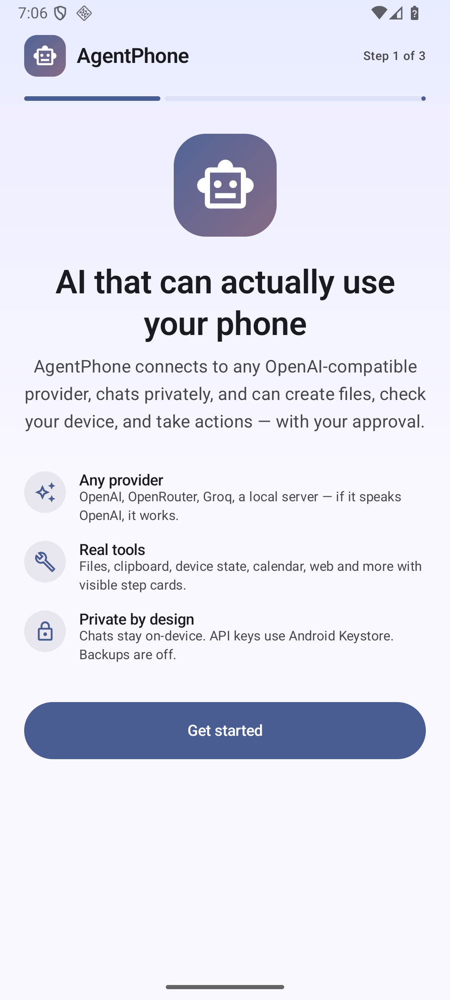
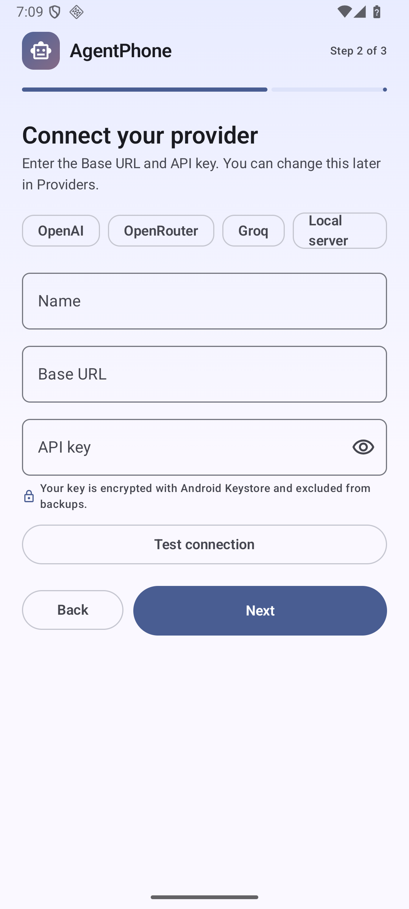
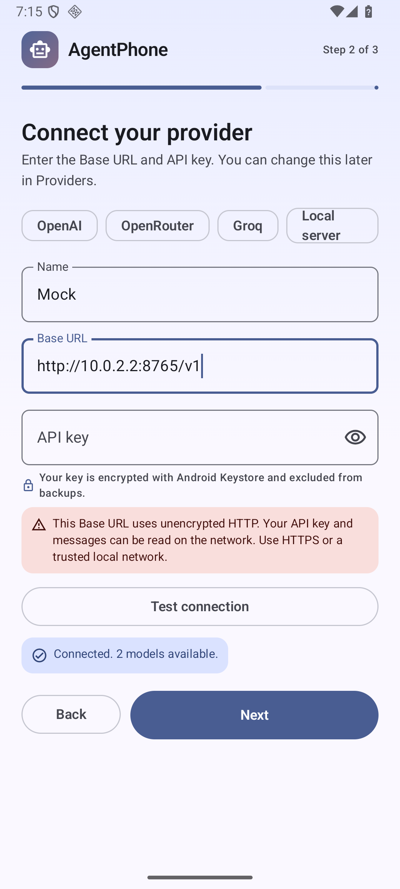
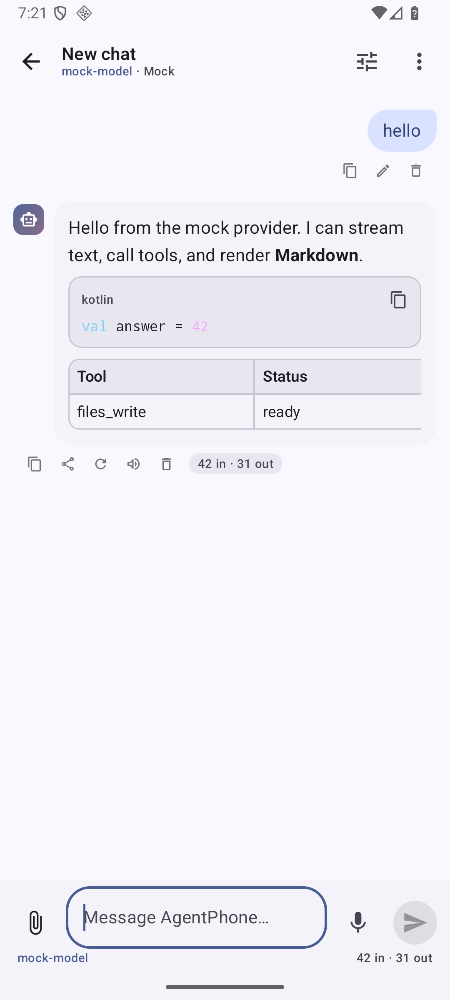
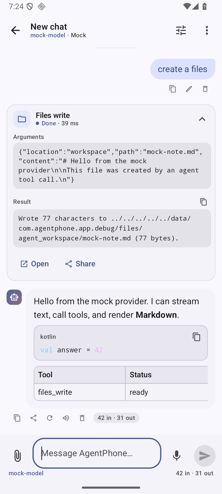
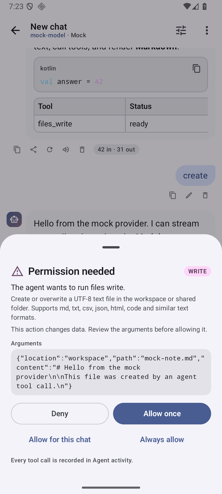
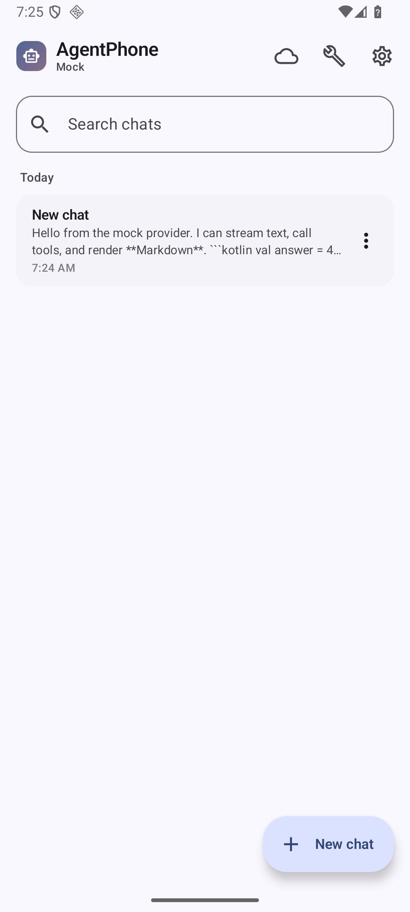
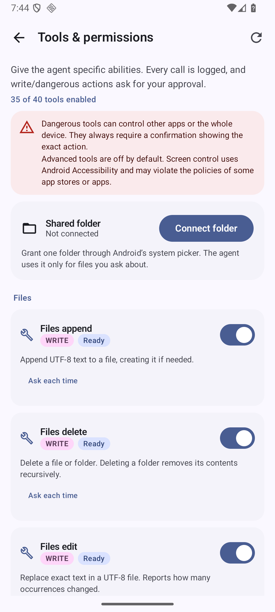
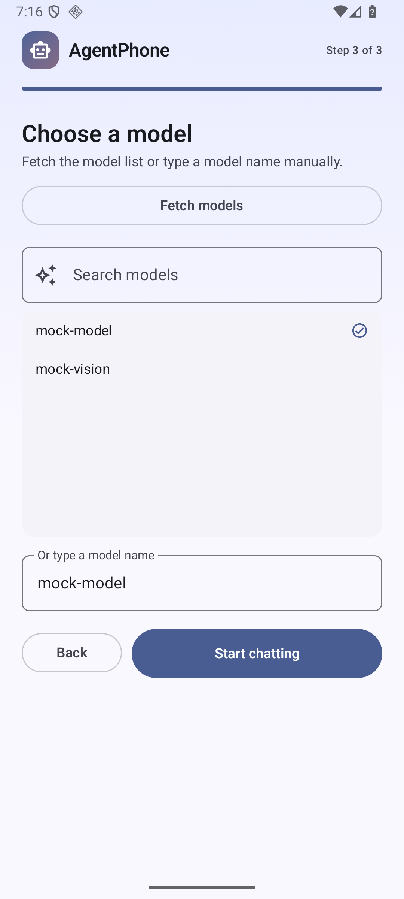
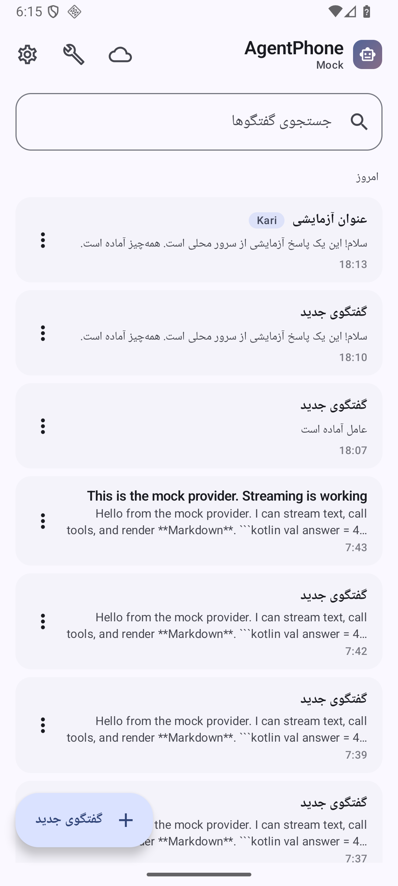

# AgentPhone

[English](README.md) · **فارسی**

دستیار هوش مصنوعی عمومی برای اندروید که واقعاً می‌تواند **روی گوشی کار انجام دهد** — فایل
بخواند و بنویسد، صفحه را ببیند، intent بفرستد، یادآور بسازد، از دوربین، تقویم، مخاطبین،
پیامک و بیشتر استفاده کند — با Tool Calling استاندارد OpenAI و هر ارائه‌دهندهٔ سازگار با
OpenAI که خودتان انتخاب می‌کنید.

Kotlin · Jetpack Compose · Material 3 · Hilt · Room · DataStore · OkHttp SSE · WorkManager ·
minSdk 26 · targetSdk 36. بدون سرور واسط، بدون تحلیل‌گر، بدون تلمتری و بدون کلید API از پیش
تعبیه‌شده.

> **دانلود:** فایل APK امضاشده به
> [آخرین انتشار گیت‌هاب](../../releases/latest) پیوست شده است. سورس این مخزن دقیقاً همان کدی
> است که آن APK از آن ساخته شده.

## ویژگی‌ها

**ارائه‌دهندهٔ دلخواه شما**
- هر Base URL سازگار با OpenAI: OpenAI، OpenRouter، DeepSeek، Groq، Together، Ollama،
  LM Studio، vLLM، LocalAI و گیت‌وی‌های شخصی.
- چند پروفایل ارائه‌دهنده، انتخاب/جست‌وجوی مدل با ورود دستی، قیمت توکن هر ارائه‌دهنده و
  هزینهٔ تخمینی هر پاسخ.
- تست اتصال با خطاهای خوانا برای ۴۰۱/۴۰۳، ۴۰۴ (Base URL اشتباه)، ۴۲۹ همراه `Retry-After`،
  Timeout، خطای DNS، مشکل TLS و HTTP بدون رمزنگاری.
- نرمال‌سازی آدرس (`api.example.com` → `/v1`، حذف `/chat/completions`)، هدرهای اختیاری
  سازمان/پروژه/سفارشی و تنظیم پنجرهٔ زمینه.
- آدرس‌های `http://` بدون رمزنگاری دقیقاً مثل HTTPS پذیرفته می‌شوند، بدون هشدار یا پیام؛
  مناسب سرورهای محلی و شبکهٔ خانگی.

**چت کامل**
- استریم توکن با توقف، تولید مجدد، ویرایش و ارسال دوباره، کپی، اشتراک‌گذاری و حذف (با تأیید).
- Markdown، جدول، هایلایت کد با دکمهٔ کپی، نمایش بازشدنی استدلال مدل، پیوست عکس، رندر
  صفحات PDF و استخراج متن از فایل‌های متنی.
- ورودی صوتی با `SpeechRecognizer` و خواندن پاسخ با `TextToSpeech`.
- فهرست گفتگوها با جست‌وجو، سنجاق، تغییر نام، عنوان خودکار، برچسب رنگی، خواندن آفلاین و
  خروجی/ورودی JSON برای همهٔ گفتگوها.
- تنظیم جداگانهٔ ارائه‌دهنده، مدل، پرامپت سیستم، temperature، top-p و حداکثر توکن برای هر گفتگو.
- رابط کامل فارسی و RTL، اعداد فارسی، تغییر زبان فارسی/انگلیسی، رنگ داینامیک، پالت‌های
  روشن/تیره، تم مشکی AMOLED، لرزش، edge-to-edge و back پیش‌بینانه.
- چیدمان دو ستونه در تبلت و تاشو، ویجت صفحهٔ اصلی، کاشی تنظیمات سریع، هدف اشتراک‌گذاری و
  deep link ‏`agentphone://chat`.

**یک ایجنت واقعی، نه فقط چت‌باکس**
- حلقهٔ چندمرحله‌ای ابزار با کارت مرحله برای هر فراخوانی، سقف مرحلهٔ قابل تنظیم، لغو و
  پاسخ نهایی تازه در آخرین مرحله.
- **۷۴ ابزار** در فایل‌ها، دستگاه، اعلان‌ها، اپ‌ها، ارتباطات، رسانه، سیستم، وب و دسترسی
  پیشرفته (فهرست کامل در [docs/TOOLS.md](docs/TOOLS.md)). کنترل سیستم شامل وای‌فای، بلوتوث،
  دادهٔ همراه، هات‌اسپات، موقعیت، حالت هواپیما، ذخیرهٔ باتری، چرخش خودکار و قفل چرخش، زمان
  خاموشی صفحه، روشنایی تطبیقی، حالت رینگر، کلیدهای رسانه، حالت تمرکز، صدا، ۳۴ مقصد تنظیمات
  و تنظیمات خام system/secure/global است. **دسترسی همهٔ فایل‌ها** (اختیاری) جست‌وجو، خواندن و
  نوشتن در کل حافظه را باز می‌کند؛ دسترسی اعلان‌ها و مصرف اپ‌ها هم ابزارهای مربوط را فعال
  می‌کند.
- ابزارهای دادهٔ شخصی: پیامک (خواندن/ارسال)، تاریخچهٔ تماس، مخاطبین (جست‌وجو/افزودن)،
  نوشتن ایمیل و تقویم (فهرست/ساخت/ویرایش/حذف)؛ ابزارهای دستگاه: گفتار، ضبط صدا، تصویر
  پس‌زمینه، لرزش، سنسورها، اطلاعات شبکه/وای‌فای/بلوتوث/سیم‌کارت؛ باز کردن فایل و نصب APK از
  طریق نصب‌کنندهٔ سیستم. هر خواندن وابسته به مجوز است و هر ارسال، حذف یا نصب **خطرناک**
  محسوب می‌شود.
- سه سطح خطر: `READ` خودکار اجرا می‌شود، `WRITE` یک‌بار اجازه می‌خواهد (با گزینهٔ «برای این
  گفتگو» یا «همیشه») و `DANGEROUS` **همیشه** می‌پرسد — هرگز بی‌صدا یا خودکار اجرا نمی‌شود.
- خروجی ابزارها و صفحات وب «دادهٔ غیرقابل‌اعتماد» هستند: داخل پوشش امن
  `<untrusted_tool_output>` قرار می‌گیرند، الگوهای تزریق پرامپت بررسی می‌شوند و با هشدار
  نمایش داده می‌شوند.
- گزارش ممیزی محلی از هر فراخوانی ابزار، آرگومان‌ها، نتیجه، وضعیت، مدت و نحوهٔ تأیید.
- کارهای پس‌زمینه با WorkManager، اعلان پیش‌زمینه و دکمهٔ لغو. چون در پس‌زمینه کسی نمی‌تواند
  تأیید کند، همهٔ ابزارهای `WRITE`/`DANGEROUS` آنجا خودکار رد می‌شوند.
- سرور MCP از راه دور (HTTP/SSE) و سرویس دسترسی‌پذیری برای خواندن/کنترل صفحه، هر دو
  اختیاری و به‌طور پیش‌فرض خاموش.

**امنیت و حریم خصوصی به‌طور پیش‌فرض**
- کلید API با AES-256-GCM و کلید غیرقابل‌استخراج Android Keystore رمزنگاری می‌شود. بدون
  `EncryptedSharedPreferences`، بدون کلید متنی و بدون کلید در لاگ‌ها.
- پشتیبان‌گیری غیرفعال است و همهٔ دامنه‌های backup/transfer حذف شده‌اند؛ کلیدها و گفتگوها
  هرگز از طریق پشتیبان اندروید از دستگاه خارج نمی‌شوند.
- گفتگوها، تنظیمات و گزارش ممیزی روی دستگاه می‌مانند. هیچ تحلیل‌گر یا ارسال گزارش خرابی وجود
  ندارد.
- دسترسی فایل به‌طور پیش‌فرض به فضای کاری اپ یا پوشهٔ SAF انتخابی کاربر محدود است. دسترسی کل
  حافظه اختیاری است: تا وقتی کاربر در تنظیمات اندروید **All files access** را نداده خاموش
  است و هر عملیات مخرب فایل باز هم `DANGEROUS` و نیازمند تأیید است.
- `dial_number` فقط صفحهٔ شماره‌گیری را باز می‌کند و نمی‌تواند تماس بگیرد.
- مدل تهدید کامل، جدول مجوزها و محدودیت‌های اندروید در
  [docs/SECURITY.md](docs/SECURITY.md) آمده است.

## تصاویر برنامه

| خوش‌آمدگویی | تنظیم ارائه‌دهنده | تست اتصال |
| --- | --- | --- |
|  |  |  |

| چت | مرحلهٔ ابزار | تأیید |
| --- | --- | --- |
|  |  |  |

| گفتگوها | ابزارها و مجوزها | انتخاب مدل |
| --- | --- | --- |
|  |  |  |

| فهرست گفتگوها با برچسب، فارسی و RTL |
| --- |
|  |

## نصب

۱. فایل `AgentPhone-1.0.0-release.apk` را از [آخرین انتشار](../../releases/latest) دانلود کنید.
۲. وقتی اندروید پرسید، اجازهٔ نصب از این منبع را بدهید (APK با کلید خودمان امضا شده و در
   Play Store منتشر نشده است).
۳. اپ را باز کنید، ارائه‌دهنده را انتخاب کنید، کلید API را وارد کنید و مدل را برگزینید.

پیش‌نیاز: اندروید ۸.۰ (API 26) یا جدیدتر. این APK کد بومی مخصوص خود ندارد و روی گوشی، تبلت و
امولاتور اجرا می‌شود.

درستی دانلود را با `SHA-256` منتشرشده در صفحهٔ انتشار بررسی کنید:

```bash
sha256sum AgentPhone-1.0.0-release.apk                     # لینوکس/مک
certutil -hashfile AgentPhone-1.0.0-release.apk SHA256     # ویندوز
```

## ساخت و اجرا

پیش‌نیازها:

- JDK 17
- Android SDK Platform 36 و Build Tools 36.0.0 (متغیر `ANDROID_HOME` یا `local.properties`)
- امولاتور یا گوشی با اندروید ۸.۰ (API 26) یا جدیدتر

```bash
# لینوکس / مک
./gradlew :app:assembleDebug

# ویندوز
gradlew.bat :app:assembleDebug
```

خروجی دیباگ در `app/build/outputs/apk/debug/app-debug.apk` ساخته می‌شود. نصب:

```bash
adb install -r app/build/outputs/apk/debug/app-debug.apk
```

یا پوشه را در Android Studio (Ladybug یا جدیدتر) باز کنید و Run بزنید.

دستورهای مفید:

| دستور | کار |
| --- | --- |
| `./gradlew :app:testDebugUnitTest` | تست‌های واحد JVM (موتور، SSE، نرمال‌سازی URL). |
| `./gradlew :app:lintDebug` | لینت اندروید (با خطا شکست می‌خورد). |
| `./gradlew :app:assembleRelease` | ساخت نسخهٔ انتشار با R8، کوچک‌سازی منابع و امضا. |
| `./gradlew :app:connectedDebugAndroidTest` | تست‌های رابط Compose روی دستگاه/امولاتور. |

### امضای نسخهٔ انتشار

`app/build.gradle.kts` فایل `keystore.properties` را از ریشهٔ پروژه می‌خواند و نسخهٔ انتشار را با
آن کلید امضا می‌کند. فایل تنظیمات و keystore **هرگز** کامیت نمی‌شوند (در `.gitignore` هستند):

```properties
storeFile=keystore/agentphone-release.jks
storePassword=…
keyAlias=agentphone
keyPassword=…
```

برای ساخت کلید خودتان:

```bash
keytool -genkeypair -v -keystore keystore/agentphone-release.jks -alias agentphone \
  -keyalg RSA -keysize 2048 -validity 10000
```

اگر `keystore.properties` نباشد، ساخت نسخهٔ انتشار باز هم موفق می‌شود ولی بدون امضا می‌ماند —
همان کاری که CI انجام می‌دهد. از keystore و رمزهایش نسخهٔ پشتیبان نگه دارید: اندروید به‌روزرسانی
اپی را که امضایش عوض شده نصب نمی‌کند.

## اولین اجرا

۱. **English** یا **فارسی** و یک تم انتخاب کنید (رنگ داینامیک در اندروید ۱۲+ پیش‌فرض فعال است).
۲. نام ارائه‌دهنده و Base URL را وارد کنید، مثلاً:
   - OpenAI: `https://api.openai.com/v1`
   - OpenRouter: `https://openrouter.ai/api/v1`
   - DeepSeek: `https://api.deepseek.com/v1`
   - Ollama (شبکهٔ محلی): `http://192.168.1.20:11434/v1`
   - LM Studio (شبکهٔ محلی): `http://192.168.1.20:1234/v1`
۳. کلید API را بچسبانید و **Test connection** را بزنید. اگر سرور endpoint ‏`/models` ندارد، یک
   مدل پیش‌فرض بگذارید تا تست با یک درخواست چت کوچک انجام شود.
۴. مدل را انتخاب کنید، خوش‌آمدگویی را تمام کنید و چت را شروع کنید. در **Tools & permissions**
   ببینید دستیار اجازهٔ چه کارهایی دارد؛ قابلیت‌های خطرناک خاموش شروع می‌شوند.

آدرس‌های `http://` برای سرورهای محلی بدون هشدار یا پیام پذیرفته می‌شوند. ترافیک رمزنگاری
نمی‌شود، پس برای وارد کردن کلید API ترجیحاً از HTTPS یا شبکهٔ محلی مطمئن استفاده کنید.

## ساختار پروژه

```
app/                         ماژول اپلیکیشن اندروید
├── src/main/java/com/agentphone/app/
│   ├── agent/               حلقهٔ ایجنت، مدیریت زمینه، رجیستری ابزار
│   ├── data/                Room، DataStore، آداپتور ارائه‌دهنده، پشتیبان، رمزنگاری Keystore
│   ├── domain/              مدل‌ها، قرارداد ابزار، قرارداد ارائه‌دهنده
│   ├── platform/            مجوزها، پیوست‌ها، دوربین، اعلان‌ها، TTS
│   ├── tools/               ۷۴ ابزار روی دستگاه
│   ├── ui/                  صفحه‌های Compose، ViewModelها، تم
│   ├── widget/              ویجت و کاشی تنظیمات سریع
│   └── worker/              کارگر پس‌زمینه و یادآورها
├── src/main/res/            رشته‌ها (en + fa)، تم‌ها، drawable، تنظیمات XML
└── src/test/                تست‌های واحد + ارائه‌دهندهٔ جعلی
accessibility/               ماژول اختیاری سرویس دسترسی‌پذیری
docs/                        مستندات معماری، ابزارها و امنیت
```

## مستندات

- [docs/ARCHITECTURE.md](docs/ARCHITECTURE.md) — لایه‌ها، چرخهٔ درخواست، حلقهٔ ایجنت، مدیریت
  زمینه، ذخیره‌سازی، رابط کاربری و تست.
- [docs/TOOLS.md](docs/TOOLS.md) — همهٔ ابزارها، آرگومان‌های JSON، سطح خطر، رفتار تأیید و
  گزارش ممیزی.
- [docs/SECURITY.md](docs/SECURITY.md) — ذخیرهٔ اسرار، دفاع در برابر تزریق پرامپت، جدول
  مجوزها، مدل تهدید و محدودیت‌های اندروید.

## تغییر نام اپ

۱. `app_name` را در `app/src/main/res/values/strings.xml` (و `values-fa/strings.xml`) عوض کنید.
۲. اگر بستهٔ جدید می‌خواهید، `applicationId` / `namespace` را در `app/build.gradle.kts` تغییر دهید.
۳. لایه‌های آیکون تطبیقی را زیر `app/src/main/res/mipmap-*` و
   `drawable/ic_launcher_foreground.xml` جایگزین کنید.

## محدودیت‌ها

زنگ و تایمر فقط رابط ساعت سیستم را باز می‌کنند؛ تماس فقط پیش‌شماره‌گیری می‌شود؛ حالت تمرکز،
روشنایی و کنترل صفحه به دسترسی ویژهٔ کاربر نیاز دارند؛ اجرای پس‌زمینه نمی‌تواند `WRITE` را
تأیید کند؛ متن PDF به‌صورت صفحهٔ رندرشده خوانده می‌شود نه متن استخراجی؛ ارسال پیامک، ویرایش
تقویم و نصب APK به مجوزها و اپ‌های موجود روی دستگاه وابسته است. فهرست کامل با دلیل هر مورد در
[docs/SECURITY.md](docs/SECURITY.md#known-android-limitations) آمده است.

## هشدار ایمنی

AgentPhone می‌تواند پیام بفرستد، تنظیمات را عوض کند، فایل حذف کند و نصب‌کنندهٔ سیستم را باز
کند. همهٔ این کارها همیشه با تأیید صریح درون اپ انجام می‌شوند و اقدام‌های `DANGEROUS` هرگز
خودکار تأیید نمی‌شوند. مسئولیت آنچه تأیید می‌کنید و مدلی که وصل می‌کنید با شماست. ارائه‌دهنده‌ای
را که به آن اعتماد ندارید با داده‌های شخصی وصل نکنید و قفل صفحهٔ اندروید را روشن نگه دارید.

## مجوز (License)

این پروژه تحت **مجوز MIT** منتشر شده است — متن کامل حقوقی در [LICENSE](LICENSE) است.

**MIT چه اجازه‌ای می‌دهد:** استفادهٔ شخصی یا تجاری، تغییر، ادغام در پروژه‌های دیگر، انتشار،
توزیع، واگذاری مجوز (sublicense) و فروش نسخه‌ها — بدون پرداخت حق امتیاز.

**MIT چه چیزی می‌خواهد:** هر نسخه یا بخش قابل‌توجهی از نرم‌افزار باید اعلان کپی‌رایت و اعلان
اجازه (همان فایل [LICENSE](LICENSE)) را همراه داشته باشد. حذف متن مجوز از فایل‌های اجرایی یا
سورس بازتوزیع‌شده مجاز نیست.

**MIT چه چیزی نمی‌دهد:** هیچ حق علامت تجاری یا برند نمی‌دهد؛ بنابراین فورک نمی‌تواند خود را
نسخهٔ رسمی AgentPhone معرفی کند. نرم‌افزار **«همان‌گونه که هست» و بدون هیچ ضمانتی** ارائه
می‌شود؛ نویسندگان در قبال از دست رفتن داده، تغییرات دستگاه، هزینه‌ها یا خسارات ناشی از استفاده
مسئول نیستند. خلاصه: تقریباً هر کاری با کد می‌توانید بکنید، اما ریسک با شماست و باید نام
پدیدآورنده را حفظ کنید.

کتابخانه‌های شخص ثالث (AndroidX، Kotlin، OkHttp، Room، Hilt، Compose، Jsoup و دیگران) مجوز
خودشان را دارند — بیشتر Apache-2.0 و MIT — که با MIT سازگارند. فونت‌ها، آیکون‌ها و نام‌های
محصول متعلق به صاحبانشان هستند. اپ هیچ وزن مدل و هیچ کلید API همراه ندارد.

APK امضاشده‌ای که در انتشارهای این مخزن منتشر می‌شود هم تحت همان شرایط MIT توزیع می‌شود.

## اعتبارها

ساخته‌شده با Kotlin، Jetpack Compose، Material 3، Hilt، Room، DataStore، OkHttp و WorkManager.
با تشکر از جامعهٔ متن‌باز اندروید.
