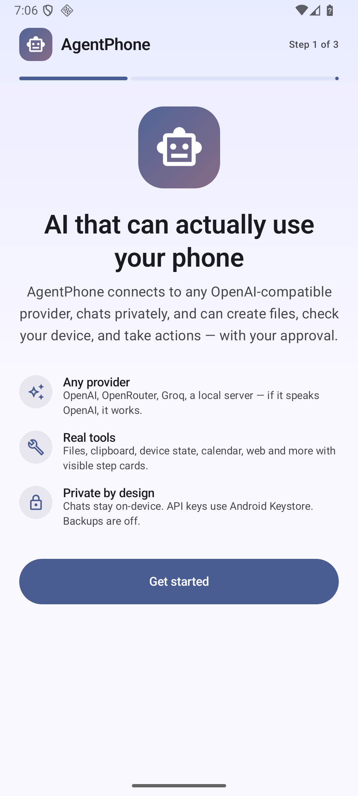
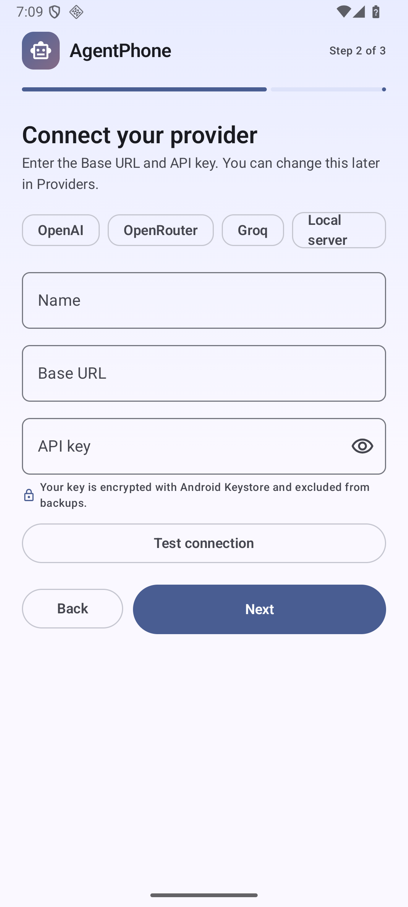
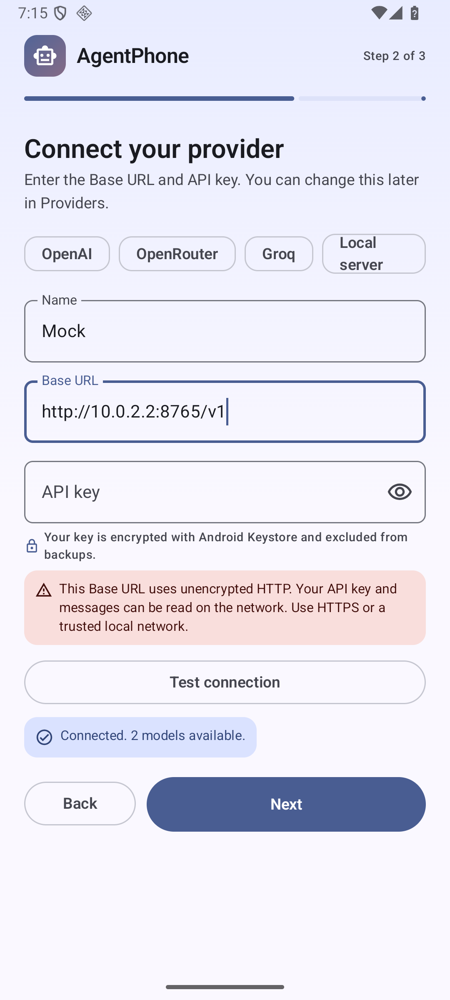
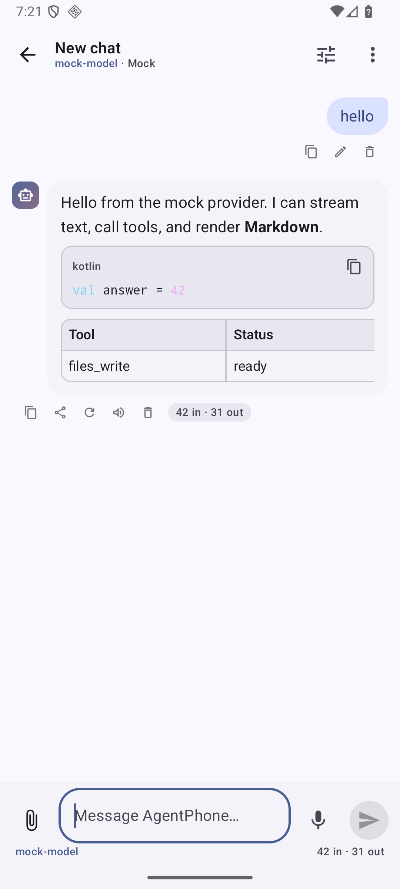
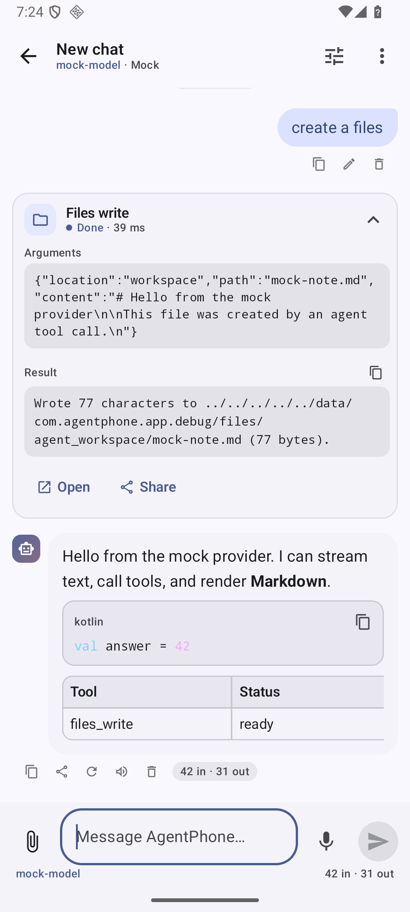
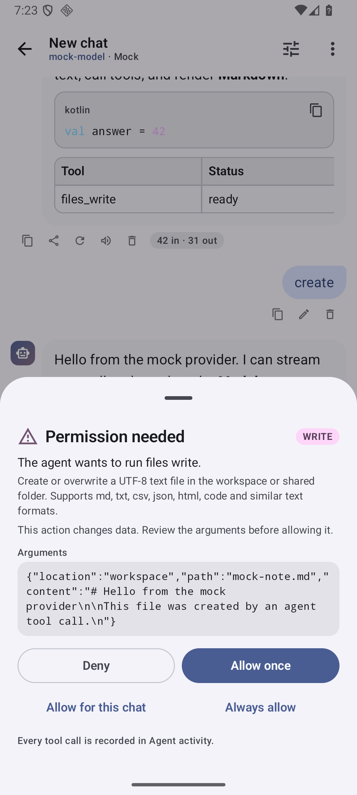
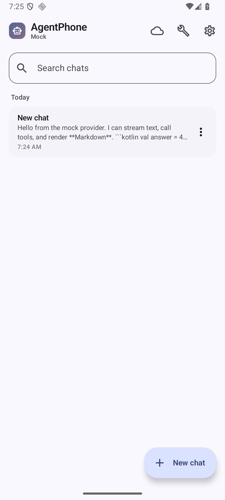
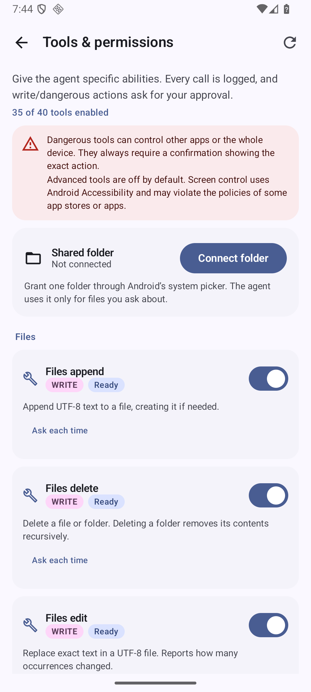
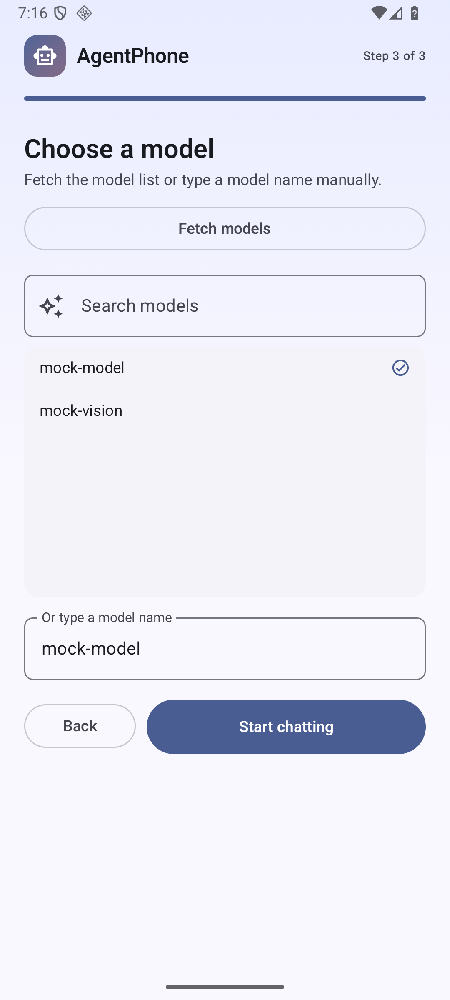
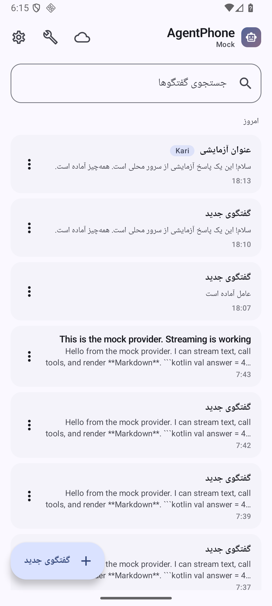

# AgentPhone

**English** · [فارسی](README.fa.md)

A general-purpose AI assistant for Android that can actually **act on the phone** — read and
write files, look at the screen, send intents, manage reminders, use the camera, calendar,
contacts, SMS and more — through standard OpenAI tool calling, with any OpenAI-compatible
provider you choose.

Kotlin · Jetpack Compose · Material 3 · Hilt · Room · DataStore · OkHttp SSE · WorkManager ·
minSdk 26 · targetSdk 36. No backend, no analytics, no telemetry, no bundled API keys.

> **Download:** the signed APK is attached to the
> [latest GitHub release](../../releases/latest). The source in this repository is the exact
> code that APK was built from.

## Highlights

**Bring your own provider**
- Any OpenAI-compatible Base URL: OpenAI, OpenRouter, DeepSeek, Groq, Together, Ollama, LM Studio,
  vLLM, LocalAI, self-hosted gateways.
- Multiple provider profiles, model picker with search and manual entry, token pricing per
  provider and an estimated cost per response.
- Connection test with human-readable errors for 401/403, 404 (wrong Base URL), 429 with
  `Retry-After`, timeouts, DNS failures, TLS problems and cleartext HTTP.
- Base-URL normalization (`api.example.com` → `/v1`, strips `/chat/completions`), optional
  organization/project/custom headers, context-window setting.
- Cleartext `http://` Base URLs are accepted exactly like HTTPS, for local and LAN servers, with
  no warning prompt.

**A real chat experience**
- Token streaming with stop, regenerate, edit-and-resend, copy, share and delete (with
  confirmation).
- Markdown, tables, syntax-highlighted code with copy buttons, collapsible reasoning/thinking,
  image attachments, PDF page rendering, and text/code attachment extraction.
- Voice input via `SpeechRecognizer`, read-aloud via `TextToSpeech`.
- Conversation list with search, pinning, renaming, auto-generated titles, colored tags, offline
  reading, and JSON export/import of all chats.
- Per-chat provider, model, system prompt, temperature, top-p and max-token overrides.
- Full RTL/Persian UI, Persian digits, English/Persian language switch, dynamic color, curated
  dark/light palettes, AMOLED black, haptics, edge-to-edge and predictive back.
- Adaptive two-pane layout on tablets/foldables; home-screen widget, Quick Settings tile,
  share target and `agentphone://chat` deep link.

**An agent, not just a chat box**
- Multi-step tool loop with a visible step card for every call, a configurable step limit,
  cancellation, and a fresh final answer on the last step.
- 74 tools across files, device, notifications, apps, communication, media, system, web and
  advanced accessibility (see [docs/TOOLS.md](docs/TOOLS.md)). System control includes Wi-Fi,
  Bluetooth, mobile data, hotspot, location, airplane mode, battery saver, auto-rotate and
  rotation lock, screen timeout, adaptive brightness, ringer mode, media keys, Do Not Disturb,
  volume, 34 settings destinations and raw system/secure/global settings. Optional **All files
  access** unlocks whole-storage search, read and write; notification access and usage access
  unlock notification and app-usage tools.
- Personal data tools for SMS (read/send), call history, contacts (search/create), email compose
  and calendars (list/create/update/delete); device tools for text-to-speech, audio recording,
  wallpaper, vibration, sensors, network/Wi-Fi/Bluetooth/SIM details; file opening and APK
  install through the system installer. Every read is permission-gated and every send, delete or
  install is `DANGEROUS`.
- Three risk levels. `READ` runs automatically, `WRITE` asks once (with chat/always grants), and
  `DANGEROUS` **always** asks — it can never be silently triggered or auto-approved.
- Tool output and web pages are treated as untrusted data, wrapped in an escaped
  `<untrusted_tool_output>` envelope, screened for prompt injection, and shown with a warning.
- Full local audit log of every tool call, arguments, result, status, duration and approval mode.
- Background tasks through WorkManager with a foreground notification and cancel action. Because
  no user can approve in the background, all `WRITE`/`DANGEROUS` tools are auto-denied there.
- Optional remote MCP server (HTTP/SSE) and an optional accessibility service for screen reading
  and control; both are off by default.

**Security and privacy by default**
- API keys are encrypted with AES-256-GCM using a non-exportable Android Keystore key. No
  `EncryptedSharedPreferences`, no plain-text keys, no keys in logs.
- Backups are disabled and every backup/transfer domain is excluded, so keys and chats never
  leave the device through Android backup.
- Chats, settings and the audit log stay on the device. There is no analytics or crash upload.
- File access is limited to the app workspace or a user-picked SAF folder by default. Whole-storage
  access is opt-in: it is off until the user grants **All files access** in Android settings, and
  every destructive file action is still `DANGEROUS` and confirmed.
- `dial_number` only opens the dialer; it cannot place a call.
- See [docs/SECURITY.md](docs/SECURITY.md) for the full threat model, permission table and
  Android limitations.

## Screenshots

| Onboarding | Provider setup | Connection test |
| --- | --- | --- |
|  |  |  |

| Chat | Tool step | Approval |
| --- | --- | --- |
|  |  |  |

| Conversations | Tools & permissions | Model picker |
| --- | --- | --- |
|  |  |  |

| Persian RTL with chat tags |
| --- |
|  |

## Install

1. Download `AgentPhone-1.0.0-release.apk` from the [latest release](../../releases/latest).
2. Allow installing from this source when Android asks (the APK is self-signed; there is no Play
   Store listing).
3. Open the app, pick a provider, paste your API key and choose a model.

Requirements: Android 8.0 (API 26) or newer. The APK contains no native code of its own, so it
runs on phones, tablets and emulators alike.

Verify the download against the `SHA-256` published with the release:

```bash
sha256sum AgentPhone-1.0.0-release.apk                     # Linux/macOS
certutil -hashfile AgentPhone-1.0.0-release.apk SHA256     # Windows
```

## Build and run

Requirements:

- JDK 17
- Android SDK Platform 36 and Build Tools 36.0.0 (`ANDROID_HOME` or `local.properties`)
- An emulator or device running Android 8.0 (API 26) or newer

```bash
# Linux / macOS
./gradlew :app:assembleDebug

# Windows
gradlew.bat :app:assembleDebug
```

The debug APK is written to `app/build/outputs/apk/debug/app-debug.apk`. Install it with:

```bash
adb install -r app/build/outputs/apk/debug/app-debug.apk
```

Or open the folder in Android Studio (Ladybug or newer) and press Run.

Useful commands:

| Command | What it does |
| --- | --- |
| `./gradlew :app:testDebugUnitTest` | JVM unit tests (engine, SSE, URL normalization). |
| `./gradlew :app:lintDebug` | Android Lint (fails on errors). |
| `./gradlew :app:assembleRelease` | R8-minified, resource-shrunk, signed release build. |
| `./gradlew :app:connectedDebugAndroidTest` | Compose UI tests on a connected device/emulator. |

### Release signing

`app/build.gradle.kts` reads `keystore.properties` from the project root and signs the release
build with that key. The property file and the keystore are **never** committed (they are listed
in `.gitignore`):

```properties
storeFile=keystore/agentphone-release.jks
storePassword=…
keyAlias=agentphone
keyPassword=…
```

Create your own key with:

```bash
keytool -genkeypair -v -keystore keystore/agentphone-release.jks -alias agentphone \
  -keyalg RSA -keysize 2048 -validity 10000
```

If `keystore.properties` is missing, the release build still succeeds but stays unsigned, which
is what CI does. Keep the keystore and its passwords backed up: Android will refuse to update an
installed app whose signature changed.

## First run

1. Choose **English** or **فارسی** and a theme (dynamic color is enabled by default on Android 12+).
2. Enter a provider name and Base URL, for example:
   - OpenAI: `https://api.openai.com/v1`
   - OpenRouter: `https://openrouter.ai/api/v1`
   - DeepSeek: `https://api.deepseek.com/v1`
   - Ollama (LAN): `http://192.168.1.20:11434/v1`
   - LM Studio (LAN): `http://192.168.1.20:1234/v1`
3. Paste the API key and press **Test connection**. If the server has no `/models` endpoint, set a
   default model and the test falls back to a tiny chat completion.
4. Pick a model, finish onboarding, and start chatting. Open **Tools & permissions** to review what
   the assistant may do; dangerous capabilities start disabled.

Cleartext `http://` URLs are accepted for local servers with no warning or prompt. Traffic is
unencrypted, so prefer HTTPS or a trusted LAN when you enter an API key.

## Project structure

```
app/                         Android application module
├── src/main/java/com/agentphone/app/
│   ├── agent/               Agent loop, context manager, tool registry
│   ├── data/                Room, DataStore, provider adapters, backups, Keystore cipher
│   ├── domain/              Models, tool contract, provider contract
│   ├── platform/            Permissions, attachments, camera, notifications, TTS
│   ├── tools/               74 on-device tools
│   ├── ui/                  Compose screens, ViewModels, theme
│   ├── widget/              App widget and Quick Settings tile
│   └── worker/              Background agent and reminder workers
├── src/main/res/            Strings (en + fa), themes, drawables, XML config
└── src/test/                Unit tests + fake provider
accessibility/               Optional accessibility service module
docs/                        Architecture, tools and security documentation
```

## Documentation

- [docs/ARCHITECTURE.md](docs/ARCHITECTURE.md) — layers, request lifecycle, agent loop,
  context management, persistence, UI and testing.
- [docs/TOOLS.md](docs/TOOLS.md) — every tool, its JSON arguments, risk level, approval behavior
  and audit record.
- [docs/SECURITY.md](docs/SECURITY.md) — secret storage, prompt-injection defenses, permission
  table, threat model and Android limitations.

## Renaming the app

1. Change `app_name` in `app/src/main/res/values/strings.xml` (and `values-fa/strings.xml`).
2. Change `applicationId` / `namespace` in `app/build.gradle.kts` if you need a new package.
3. Replace the adaptive icon layers under `app/src/main/res/mipmap-*` and
   `drawable/ic_launcher_foreground.xml`.

## Limitations

Alarms and timers open the system clock UI; calls can only be pre-dialed; DND, brightness and
screen control require special user-granted access; background runs cannot approve `WRITE`
actions; PDF text is read as rendered pages, not extracted text; SMS sending, calendar edits and
APK installs depend on the permissions and apps present on the device. The full list, with the
reason for each, is in [docs/SECURITY.md](docs/SECURITY.md#known-android-limitations).

## Safety notice

AgentPhone can send messages, change settings, delete files and open the system installer. Those
actions are always gated by an explicit confirmation in the app, and `DANGEROUS` actions can never
be auto-approved. You remain responsible for what you approve and for the model you connect. Do
not connect a provider you do not trust with personal data, and keep Android's screen lock on.

## License

This project is released under the **MIT License** — the full legal text is in
[LICENSE](LICENSE).

**What MIT lets you do:** use AgentPhone privately or commercially, modify it, merge it into
other projects, publish it, distribute it, sublicense it and sell copies — royalty-free.

**What it requires:** every copy or substantial portion of the software must keep the copyright
notice and the permission notice (the [LICENSE](LICENSE) file). You may not remove the license
text from redistributed binaries or source.

**What it does not grant:** MIT grants no trademark or branding rights, so a fork may not present
itself as the official AgentPhone release. The software is provided **"as is", without warranty of
any kind**; the authors are not liable for data loss, device changes, charges or other damages
caused by using it. In short: you may do almost anything with the code, but you carry the risk
and you must keep the attribution.

Third-party libraries (AndroidX, Kotlin, OkHttp, Room, Hilt, Compose, Jsoup and others) keep their
own licenses — mostly Apache-2.0 and MIT — which are compatible with MIT. Fonts, icons and product
names belong to their respective owners. The app ships with no model weights and no API keys.

The signed APK published in this repository's releases is distributed under the same MIT terms.

## Credits

Built with Kotlin, Jetpack Compose, Material 3, Hilt, Room, DataStore, OkHttp and WorkManager.
Thanks to the Android open-source community.
